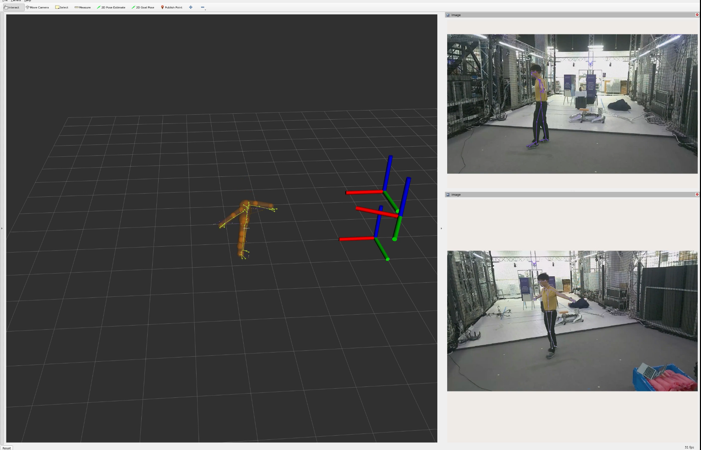

# zedx_driver_ros2

This repository allows bringup and body tracking of a ZEDX Camera. The cameras are attached to a ZED Box and the primary compute is on a more powerful networked computer. 

USB cameras such as the ZED Mini are also supported, see [ZED Mini](#zed-mini).

## Usage
The instructions assume you will be splitting compute between the ZED Box and a networked workstation computer with an RTX GPU

### ZED Box Setup
On the ZED Box: 
1. Clone the repository
```
git clone --recursive https://github.com/Abanesjo/zedx_driver_ros2
```
2. ROS 2 communication uses `rmw_zenoh`. Leave `src/RMW_ZENOH_ROUTER_CONFIG.json5` as it is on the ZED Box
3. On the `docker/Dockerfile`, set the base image and ROS distro for the machine (see [Base Image](#base-image)). For a Jetson AGX Thor:
```
FROM stereolabs/zed:5.3.0-py-devel-l4t-r38.4
ARG ROS_DISTRO=jazzy
```
4. Create the docker container
```
cd docker
docker compose up
```
5. Start the Zenoh router (within the docker container) and leave it running. Nodes cannot discover each other without it
```
docker exec -it zedx_driver_ros2 bash
ros2 run rmw_zenoh_cpp rmw_zenohd
```
6. Start the ZED server (within the docker container)
```
docker exec -it zedx_driver_ros2 bash
ros2 launch zed_launcher server.launch.xml
```
7. (Optional) You can run body tracking directly on the ZED Box
```
docker exec -it zedx_driver_ros2 bash
ros2 launch zed_launcher body_tracking.launch.xml debug:=true rviz:=true
```

Now that the jetson/ZED Box is setup, we now launch on the separate compute.
### Networked Workstation Setup
On the Networked Workstation: 
1. Clone the repository
```
git clone --recursive https://github.com/Abanesjo/zedx_driver_ros2
```
2. In `src/RMW_ZENOH_ROUTER_CONFIG.json5`, add the ZED Box router to `connect.endpoints` so the two routers find each other, for example `endpoints: ["tcp/192.168.0.133:7447"]`
3. On the `docker/Dockerfile`, set the base image and ROS distro for the machine (see [Base Image](#base-image)):
```
FROM stereolabs/zed:5.3-gl-devel-cuda12.8-ubuntu24.04
ARG ROS_DISTRO=jazzy
```
4. Create the docker container
```
cd docker
docker compose up
```
5. Start the Zenoh router (within the docker container) and leave it running
```
docker exec -it zedx_driver_ros2 bash
ros2 run rmw_zenoh_cpp rmw_zenohd
```
6. Start the Body Tracking (within the docker container)
```
docker exec -it zedx_driver_ros2 bash
ros2 launch zed_launcher body_tracking.launch.xml debug:=true rviz:=true
```

Setting `debug:=true` publishes as images the annotated 2d skeleton on each camera image, the 3d skeleton per image, and the fused 3d skeleton. Disabling it is recommended for improving performance. 

7. For the human angle calculation and collision capsules, run:
```
docker exec -it zedx_driver_ros2 bash
ros2 launch human_mapping human_mapping.launch.xml
```

You should see a visualization like below



The axes also show the position of the cameras in the world frame. 

## Base Image
The `FROM` line and the `ROS_DISTRO` argument at the top of `docker/Dockerfile` must match the machine. The Ubuntu version of the image decides which ROS distro can be installed.

| Machine | `FROM` | `ROS_DISTRO` |
|---|---|---|
| Jetson AGX Thor (JetPack 7) | `stereolabs/zed:5.3.0-py-devel-l4t-r38.4` | `jazzy` |
| Workstation with an RTX GPU | `stereolabs/zed:5.3-gl-devel-cuda12.8-ubuntu24.04` | `jazzy` |
| JetPack 6 Jetson / ZED Box | `stereolabs/zed:5.3.0-py-devel-l4t-r36.4` | `humble` |

All machines that exchange ROS topics must use the same distro: `rmw_zenoh` does not carry messages between Humble and Jazzy. The camera stream between `server.launch.xml` and `body_tracking.launch.xml` is not a ROS topic and is not affected.

## ZED Mini
Two ZED Minis plugged into the same computer need no stream server: `zed_mini.launch.xml` runs body tracking directly on the local cameras. Start the Zenoh router as above, then:
```
ros2 launch zed_launcher zed_mini.launch.xml debug:=true rviz:=true
```
It defaults to VGA at 100 fps, `depth_mode:=NEURAL` and `body_model:=HUMAN_BODY_MEDIUM`. Measured on a Jetson AGX Thor with one ZED Mini, this is the heaviest combination that keeps the fused skeleton at 60 Hz: HD720 only reaches 25 to 45 Hz, `HUMAN_BODY_ACCURATE` drops below 60 Hz, and `HUMAN_BODY_FAST` often loses the person at VGA. The valid resolution and frame rate combinations are listed at the top of `src/zed_launcher/launch/zed_mini.launch.xml`; override them with `camera_resolution:=` and `camera_fps:=`.

The cameras are opened by serial number. For other ZED Minis, pass `left_serial:=` and `right_serial:=` (shown by `ZED_Explorer -a`) and update the calibration file.

## Calibration
The ZED X calibration is `src/zed_launcher/calibration/zedx/calibration.json` and the ZED Mini calibration is `src/zed_launcher/calibration/zedm/calibration.json`. To calibrate the cameras, update that file with the output obtained from the [ZED360](https://www.stereolabs.com/docs/fusion/zed360) tool, then rebuild `zed_launcher`.
